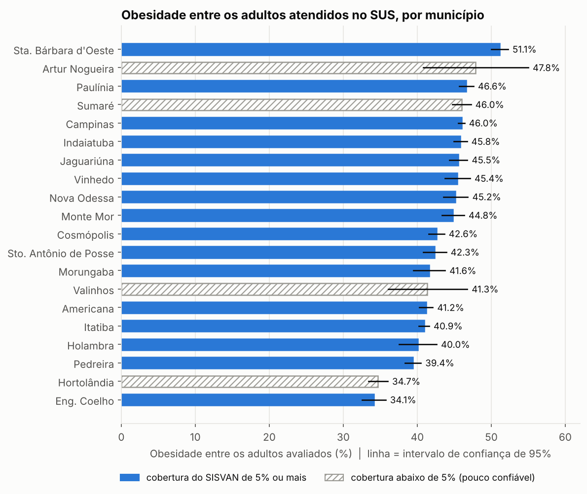
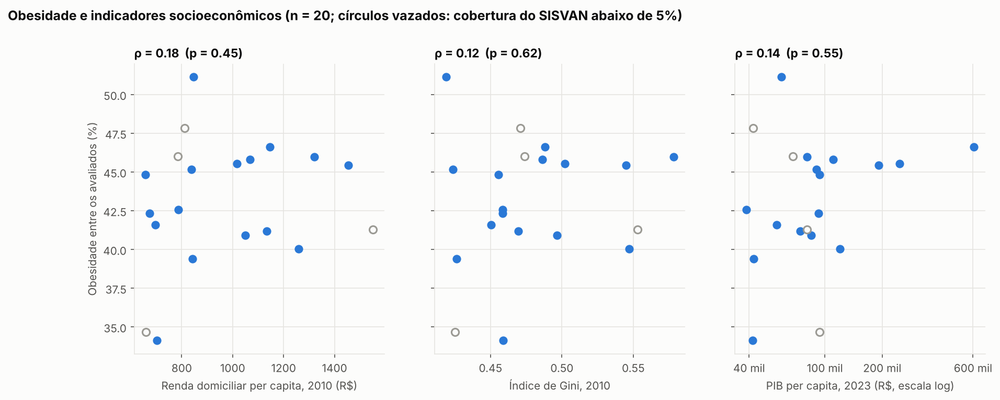
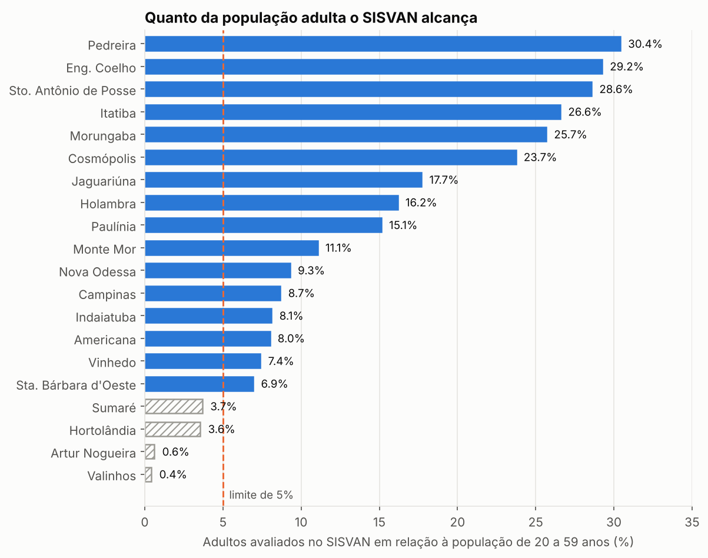
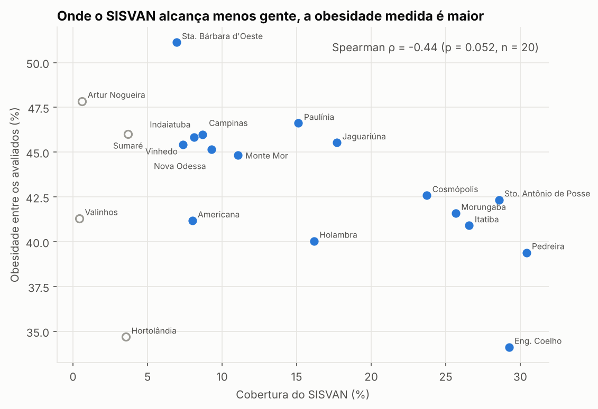
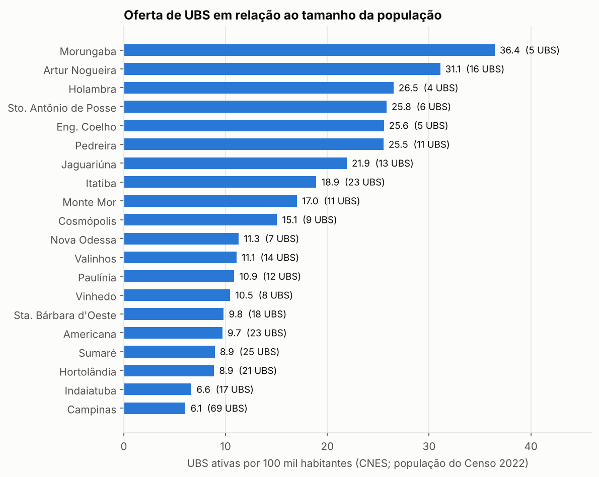
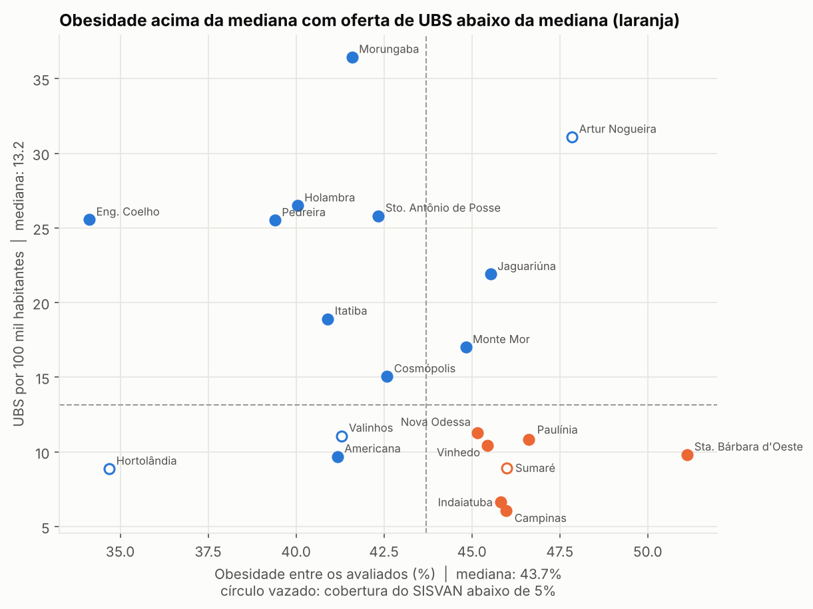
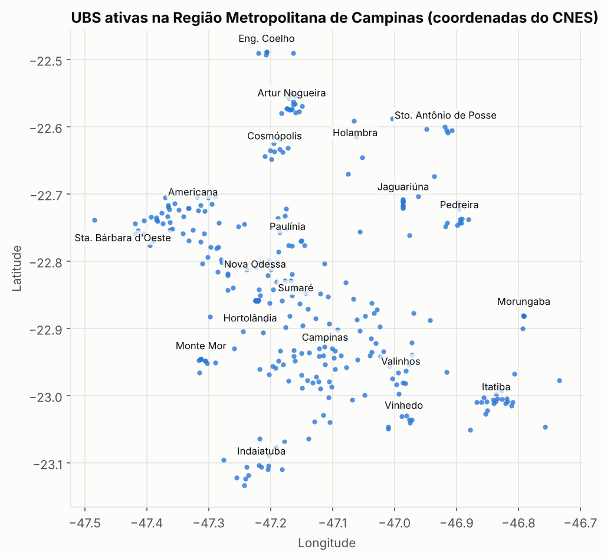

# Saúde nutricional na Região Metropolitana de Campinas

Análise em SQL e Python sobre obesidade em adultos, cobertura do SISVAN, renda e oferta de UBS nos 20 municípios da Região Metropolitana de Campinas (RMC).

A pergunta que guiou o trabalho: **o excesso de peso na região varia com a condição socioeconômica e com a oferta de unidades básicas de saúde, ou os dados disponíveis não permitem dizer isso?** A resposta curta é que renda, Gini e PIB não mostram relação, e que o principal achado é sobre a qualidade do dado: a cobertura do SISVAN varia de 0,4% a 30,4% da população de 20 a 59 anos e distorce qualquer comparação direta entre cidades.



## Resultados

Entre os 174.589 adultos avaliados pelo SISVAN na região, 44,1% estavam com obesidade. O excesso de peso (sobrepeso mais obesidade) vai de 68,7% a 79,9% entre os municípios. A maior taxa de obesidade é a de Santa Bárbara d'Oeste (51,1%), e a RMC tem 317 UBS ativas, cerca de 10 por 100 mil habitantes.

**Renda, desigualdade e PIB não explicam a obesidade.** As correlações de Spearman com os 20 municípios ficaram entre 0,12 e 0,18 (renda 2010, Gini 2010 e PIB per capita 2023), todas com p acima de 0,4.



**A cobertura do SISVAN muda o quadro.** O SISVAN só registra quem foi atendido na atenção primária do SUS, então não representa a população inteira. Dividindo os avaliados pela população de 20 a 59 anos (Censo 2022), a cobertura vai de 0,4% em Valinhos a 30,4% em Pedreira, e quatro municípios ficam abaixo de 5%. Nesses, a taxa de obesidade pesa pouco como retrato da cidade.



Quanto maior a cobertura, menor a obesidade medida (ρ = -0,44, p = 0,052 com os 20 municípios, e ρ = -0,69, p = 0,003 só com os 16 que têm cobertura de 5% ou mais). Isso é compatível com viés de seleção: onde poucas pessoas são avaliadas, tendem a ser as que já procuraram atendimento por causa do peso. É uma hipótese que os dados sustentam, não uma conclusão.



**UBS por habitante é, em boa parte, uma medida do tamanho da cidade.** Municípios com menos UBS por 100 mil habitantes têm obesidade um pouco maior (ρ = -0,31 com todos, -0,67 com cobertura de 5% ou mais), mas essa taxa tem correlação de -0,94 com a população total. Cidades pequenas têm sempre ao menos algumas unidades, o que infla o indicador. Por isso o gráfico abaixo agrupa os municípios em quadrantes pela mediana, para olhar casos e não tirar uma regra.





## Como foi feito

1. `src/construir_banco.py` lê os CSVs de `dados/brutos/`, valida os dados e monta um banco SQLite com tabelas, chaves, índice e uma view (`v_indicadores`). Todas as junções usam o código IBGE do município, não o nome.
2. `sql/consultas/` tem seis consultas (CTEs, funções de janela, `CASE`, `CROSS JOIN` para medianas) que respondem a perguntas específicas, de `q1` a `q6`.
3. `src/analise.py` executa as consultas, calcula as correlações de Spearman, o intervalo de Wilson para as proporções e gera os gráficos e as tabelas em `resultados/`.

Controles de qualidade que valem citar: o banco recusa linhas em que as categorias de IMC não somam o total de avaliados; coordenadas de UBS a mais de 30 km do centro do município são marcadas como inválidas e ficam fora do mapa (2 casos); o script `q6` lista municípios com coordenadas repetidas.

## Como rodar

```bash
pip install -r requirements.txt
python src/construir_banco.py
python src/analise.py
```

O banco é gerado em `dados/processados/` e os resultados em `resultados/` e `graficos/`. Os dados brutos já estão no repositório, então nada precisa ser baixado.

## Fontes dos dados

| Arquivo | Conteúdo | Origem |
|---|---|---|
| `sisvan_imc_adultos.csv` | Adultos por categoria de IMC | SISVAN, conforme levantado pelo grupo do trabalho original (o ano 2023 foi informado por ele e não foi reconferido aqui) |
| `ibge_socioeconomico.csv` | Renda domiciliar per capita e Gini (2010), PIB per capita (2023) | IBGE, conforme levantado pelo grupo |
| `ibge_populacao_censo2022.csv` | População total e de 20 a 59 anos | API SIDRA do IBGE, tabela 9514 (Censo 2022) |
| `cnes_ubs.csv` | UBS ativas com coordenadas | API de dados abertos do CNES, consulta feita em novembro de 2026 |

## Limitações

- O SISVAN não é uma amostra da população. A comparação entre municípios depende da cobertura, e por isso ela aparece em todos os gráficos.
- A análise é ecológica, com n = 20. Uma correlação entre municípios não diz nada sobre indivíduos, e nenhum resultado aqui indica causa.
- Renda e Gini são de 2010 e o PIB é de 2023, então os indicadores não são do mesmo período.
- O trabalho em grupo usava uma lista de 155 UBS, e o CNES retorna 317. A diferença não foi reconciliada, e a base de nutricionistas por UBS do trabalho original não pôde ser recuperada, por isso essa camada não entrou.
- Não há ajuste por idade nem por sexo.

## Origem

O projeto nasceu como trabalho em grupo do Projeto Integrador de Ciência de Dados com IA na PUC-Campinas, com dados do SISVAN, IBGE e CNES. Esta versão foi refeita por mim do zero: novo banco relacional, consultas em SQL, tratamento da cobertura, correção de erros de unidade nos dados originais, validações e gráficos.

Enzo Cayres Ferreira · [LinkedIn](https://www.linkedin.com/in/enzo-cayres-ferreira-a1b22444b/)
